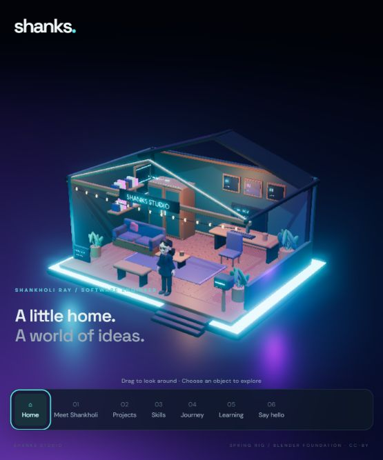

# Shanks Studio

An interactive 3D portfolio by **Shankholi Ray**: a cozy cyberpunk home built with Three.js and Blender.

**[Visit the live portfolio](https://shanks-studio.129-225-102-84.sslip.io/)**



## Explore the house

Choose **Come on in**, then click objects or use the navigation. Drag to look around; press Escape to return home.

- **Front porch:** introduction and interests.
- **Project cupboard:** animated doors and six selectable projects. The top shelf contains Collab Loop, My Portfolio, and Emotify; the lower shelf contains Zomato Clone, Readshorts, and Targeted Ad Project.
- **Workbench:** backend, Azure, and full-stack skills.
- **Memory wall:** professional experience.
- **Bookshelf:** education, certifications, and problem solving.
- **Mailbox:** contact and profile links.

The character has a gentle idle animation, and the experience respects reduced-motion preferences. Opening a project displays that project's details, with an option to return to the full project list.

## Stack

JavaScript, Three.js, Vite, HTML/CSS, and Blender Python. The production site is static; 3D rendering runs in the visitor's browser. Oracle Cloud hosts the files through an existing Caddy gateway with HTTPS.

## Run locally

Use Node.js 20.19+ or 22.12+.

```sh
npm ci
npm run dev
```

Open the local URL printed by Vite.

```sh
npm run build
npm run preview
```

The production build is written to `dist/`.

## Edit the portfolio

- `src/portfolio-content.json`: profile, experience, skills, education, certifications, contact links, and projects. `projectOrder` controls the cupboard's shelf arrangement.
- `src/house.js`: scene loading, camera transitions, object selection, animations, and content panels.
- `src/house.css`: interface styles and responsive layouts.
- `scripts/build-house.py`: generates the editable house and browser model.
- `assets/cyber-home.blend`: current editable house scene.
- `assets/spring-lite.blend`: current customized lightweight character.
- `public/models/cyber-home.glb`: self-contained browser scene with the character embedded.
- `docs/content-sources.md`: content provenance.

To regenerate the scene, use Blender in background mode:

```sh
blender --background --python scripts/build-house.py -- --no-render
```

This updates `assets/cyber-home.blend` and `public/models/cyber-home.glb`. Omit `-- --no-render` to also render a preview. The approved lightweight character is already included, so rebuilding the house does not require downloading the original Spring archive. Character customization scripts and earlier prototype source are retained for reference; their larger archived inputs and outputs are not included.

The earlier Atlas prototype is available at `/atlas.html` in the development server. It is separate from the deployed homepage.

## Oracle deployment

```sh
node scripts/package-oracle.mjs
```

This builds a dated release archive and SHA-256 manifest under `tmp/oracle/`, containing only assets used by the current homepage. See [the deployment notes](docs/oracle-deployment.md) for the existing server layout, updates, and rollback. `scripts/deploy-oracle.sh` is specific to that server and should be reviewed before use elsewhere.

Dependencies, build output, temporary deployment files, credentials, and historical Blender archives are excluded from Git.

## Character attribution

**Spring Rig (CC-BY), Blender Foundation | [studio.blender.org](https://studio.blender.org/)**

Based on [Spring by Blender Studio](https://studio.blender.org/characters/spring/v1/), licensed under [Creative Commons Attribution 4.0 International](https://creativecommons.org/licenses/by/4.0/). The customized version has simple round glasses, a single navy top, plain trousers, flat shoes, simplified hair with a parted forehead fringe and ponytail, brown-black eyes, reduced geometry/textures, and a lightweight idle rig. The original face design and proportions are retained.

See [the attribution notes](assets/spring-source/ATTRIBUTION.md) and the site's [credits page](https://shanks-studio.129-225-102-84.sslip.io/credits.html). The character license remains applicable to the included modified assets; use does not imply endorsement by Blender Foundation.
